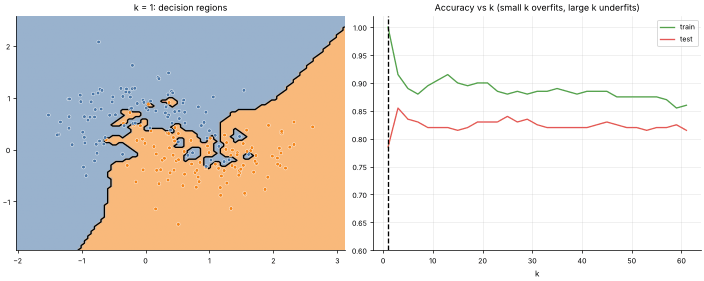
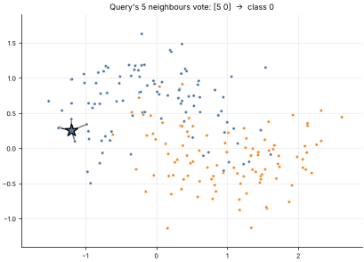

# 07 · k-Nearest Neighbors (k-NN)
**Family:** Supervised · Classification / Regression (instance-based, non-parametric)

## Definition
k-NN does no training at all. To classify a new point it finds the k most similar stored examples (nearest by distance)
and takes a majority vote (classification) or an average (regression). The "model" *is* the training data.

## Intuition
"Tell me who your neighbours are and I'll tell you who you are." A small k follows every quirk of the data (low bias,
high variance); a large k blurs everything toward the global majority (high bias, low variance).

## The math
    d(x, xᵢ) = ||x − xᵢ||₂      (or Manhattan, cosine, ...)
    ŷ(x) = argmax_c  Σ_{i ∈ N_k(x)} 1[yᵢ = c]            regression: ŷ = mean of the k neighbours' y
    Weighted variant: each neighbour votes with weight 1/d.

## Practical tips
- **Scale features** (distance is dominated by large-range features). Beware the curse of dimensionality.
- Prediction cost grows with the dataset (use KD-trees / approximate NN such as FAISS or HNSW).
- k chosen by cross-validation; odd k avoids ties in binary problems.

## What the animations show
1. `07_k_nearest_neighbors.gif`: the decision regions for k = 1 … 61 on noisy moons, plus train/test accuracy. k=1 is
   a jagged island map with 100 % training accuracy; huge k is too smooth.
2. `07_k_nearest_neighbors_query.gif`: a query point glides through the data; lines connect it to its 5 neighbours who vote.

## Try this
- Multiply one feature by 100 before computing distances: watch the model ignore the other feature.
- Implement distance-weighted voting and compare accuracy at k = 15.

## Formats
- **Interactive Notebook:** [`notebooks/07_k_nearest_neighbors.ipynb`](../notebooks/07_k_nearest_neighbors.ipynb)
- **Standalone Python Script:** [`lessons/07_k_nearest_neighbors.py`](../lessons/07_k_nearest_neighbors.py)

