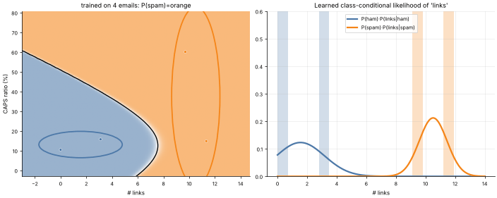

# 08 · Naive Bayes
**Family:** Supervised · Classification (probabilistic, generative)

## Definition
Naive Bayes applies **Bayes' theorem** to classification and makes one big simplifying ("naive") assumption: given the class,
all features are independent. It models how each class *generates* its features, then inverts that to get P(class | features).

## Intuition
A spam filter learns: spam emails usually have many links and lots of CAPS; ham rarely does. For a new email, multiply
how plausible each observed feature is under "spam" by the spam prior, do the same for "ham", and normalise. The independence
assumption is false (links and CAPS correlate) but the ranking of classes is often still right, so it works surprisingly well.

## The math
    P(c | x) ∝ P(c) · Π_j P(x_j | c)
    Gaussian NB:   P(x_j | c) = N(x_j ; μ_cj , σ²_cj)     (parameters = per-class mean and variance, just counts!)
    Compute in log-space:  log P(c) + Σ_j log P(x_j | c)   to avoid underflow.
    Text (multinomial NB): P(word | c) = (count + α) / (total + α·V)   with Laplace smoothing α.

## Strengths & weaknesses
- Extremely fast, works with tiny datasets and huge feature spaces (text), naturally multi-class, online-updatable.
- Probabilities are poorly calibrated (over-confident); can't learn feature interactions.

## What the animation shows
Spam data (links vs CAPS ratio). As more training emails arrive (4 → 400) watch the fitted per-class Gaussians
(ellipses = 2σ) sharpen, the posterior map stabilise, and (right) the 1-D likelihoods P(links | class).

## Try this
- Print the log-posterior terms for a custom email and see which feature dominated the decision.
- Break the assumption: duplicate a feature 5× and watch the classifier become over-confident.

## Formats
- **Interactive Notebook:** [`notebooks/08_naive_bayes.ipynb`](../notebooks/08_naive_bayes.ipynb)
- **Standalone Python Script:** [`lessons/08_naive_bayes.py`](../lessons/08_naive_bayes.py)

