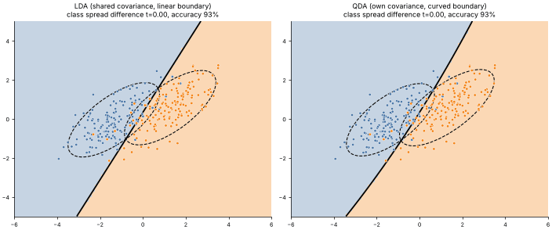

# 09 · Linear & Quadratic Discriminant Analysis (LDA / QDA)
**Family:** Supervised · Classification (generative, Gaussian class models)

## Definition
LDA and QDA model each class as a multivariate Gaussian N(μ_c, Σ_c) and classify with Bayes' rule.
**LDA** assumes all classes share the *same* covariance matrix, which gives a **linear** boundary.
**QDA** lets every class have its own covariance, which gives a **quadratic (curved)** boundary.

## Intuition
Unlike naive Bayes, these models keep correlations between features (tilted ellipses, not axis-aligned ones). LDA pools all the
data to estimate one shape, which is stable with few samples. QDA is more flexible but needs more data (it estimates d² numbers per class).

## The math
    discriminant  δ_c(x) = −½ log|Σ_c| − ½ (x−μ_c)ᵀ Σ_c⁻¹ (x−μ_c) + log π_c        predict argmax_c δ_c(x)
    LDA: Σ_c = Σ (pooled)  =>  the quadratic terms cancel, leaving the linear  w·x + b
    LDA doubles as supervised dimensionality reduction: project onto the directions maximizing between-class / within-class scatter.

## When to use
- Small data + roughly Gaussian classes: LDA is hard to beat. Classes with clearly different spreads: QDA.
- Regularized discriminant analysis (shrink Σ_c toward Σ) interpolates between the two.

## What the animation shows
Two classes whose covariances start identical and gradually become different (t: 0 → 1). Left: LDA's straight boundary
cannot adapt; right: QDA's boundary curves around the narrower class. Ellipses = fitted 2σ class shapes.

## Try this
- Make the means identical but the covariances different: LDA fails completely, QDA still works.
- Shrink Σ_c toward the pooled Σ with a factor λ and plot accuracy vs λ.

## Formats
- **Interactive Notebook:** [`notebooks/09_discriminant_analysis_lda_qda.ipynb`](../notebooks/09_discriminant_analysis_lda_qda.ipynb)
- **Standalone Python Script:** [`lessons/09_discriminant_analysis_lda_qda.py`](../lessons/09_discriminant_analysis_lda_qda.py)

