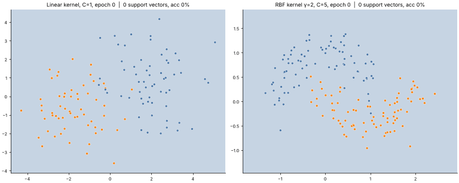
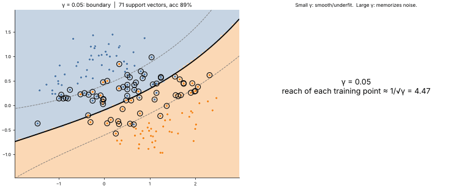

# 10 · Support Vector Machines (SVM) & the Kernel Trick
**Family:** Supervised · Classification (margin-based)

## Definition
An SVM finds the decision boundary with the **largest margin**: the widest street separating the two classes.
Only the points touching the street edges, the **support vectors**, matter; every other point could be deleted without
changing the model. The **kernel trick** lets the same algorithm draw curved boundaries by implicitly mapping points
into a high-dimensional space.

## Intuition
Many lines separate two classes, but the one farthest from both is the most robust to noise. If the classes overlap,
the **soft margin** parameter C says how much you are willing to pay for points inside the street or misclassified
(small C = wide, tolerant street; large C = strict, may overfit).

## The math
    Primal (soft margin):  min ½||w||² + C Σ max(0, 1 − yᵢ(w·xᵢ + b))        (hinge loss)
    Dual:                  max Σ αᵢ − ½ Σᵢⱼ αᵢ αⱼ yᵢ yⱼ K(xᵢ,xⱼ)    s.t.  0 ≤ αᵢ ≤ C
    Decision:              f(x) = Σ αᵢ yᵢ K(xᵢ, x) + b           support vectors = points with αᵢ > 0
    Kernels:               linear  K = x·x' ;  RBF  K = exp(−γ||x − x'||²) ;  polynomial  K = (x·x' + 1)ᵈ
    Here we absorb b into the kernel (K+1) and solve the dual by coordinate ascent, one αᵢ at a time:
                           αᵢ ← clip(αᵢ + (1 − yᵢ f(xᵢ)) / Qᵢᵢ , 0, C)

## Practical tips
- Scale features. Tune C and γ together by grid search. Great on small/medium data; O(n²–n³) training cost.
- Large γ = every point is its own island (overfit). Small γ ≈ linear.

## What the animations show
1. `10_support_vector_machine.gif`: dual coordinate ascent epoch by epoch. Left: linear kernel on overlapping blobs; right: RBF kernel
   on moons. Solid line = boundary f=0, dashed = margins f=±1, ringed points = support vectors.
2. `10_support_vector_machine_hyper.gif`: how γ (flexibility) changes the RBF boundary from nearly linear to overfit.

## Try this
- Plot accuracy against C on a log scale for both datasets.
- Use the polynomial kernel (degree 3) on the circles dataset.

## Formats
- **Interactive Notebook:** [`notebooks/10_support_vector_machine.ipynb`](../notebooks/10_support_vector_machine.ipynb)
- **Standalone Python Script:** [`lessons/10_support_vector_machine.py`](../lessons/10_support_vector_machine.py)

