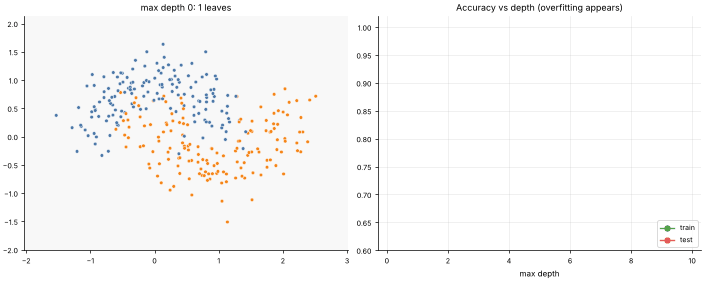
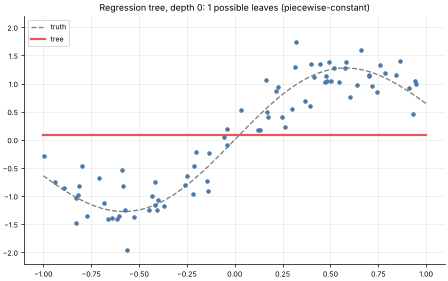

# 11 · Decision Trees (CART)
**Family:** Supervised · Classification & Regression (non-linear, rule-based)

## Definition
A decision tree asks a sequence of yes/no questions about single features ("is income ≤ 43?"), splitting the data into
ever purer groups, until a leaf makes a prediction (majority class, or the mean for regression). It is the same as a set of
if/else rules and is the most human-readable ML model.

## Intuition
Twenty-questions for data. At each node, try every feature and every threshold and choose the split that makes the two
children as *pure* as possible. Recurse until a depth limit or until nodes are pure. Deep trees memorise the training set,
so depth/leaf-size is the main complexity dial (and the reason for pruning).

## The math
    Gini impurity   G = 1 − Σ_c p_c²              Entropy   H = − Σ_c p_c log p_c
    Best split      argmin over (feature j, threshold t) of   n_L·G(L) + n_R·G(R)
    Regression      same recipe with variance (SSE) instead of Gini; leaf = mean of y
    Feature importance = total impurity reduction attributed to that feature.

## Strengths & weaknesses
- No scaling needed, handles mixed types/missing values (with tweaks), captures interactions, interpretable.
- Unstable (small data changes → different tree), axis-aligned boundaries only, overfits easily.
  Ensembles (lessons 12–14) fix instability.

## What the animations show
1. `11_decision_tree.gif`: the tree grows level by level on noisy moons; black lines are the chosen split thresholds (thicker =
   earlier), shaded regions are the predictions. Right: train accuracy keeps climbing while test accuracy peaks then falls.
2. `11_decision_tree_regression.gif`: a regression tree approximating a smooth curve with staircase steps.
The console prints the rules of a depth-3 tree on loan data.

## Try this
- Set `min_samples=10` to prune: does the test curve flatten instead of falling?
- Replace Gini by entropy in `trees.py` and compare trees.

## Formats
- **Interactive Notebook:** [`notebooks/11_decision_tree.ipynb`](../notebooks/11_decision_tree.ipynb)
- **Standalone Python Script:** [`lessons/11_decision_tree.py`](../lessons/11_decision_tree.py)

