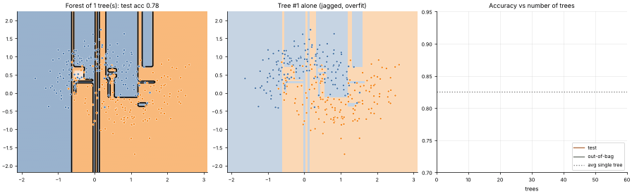

# 12 · Random Forest (Bagging)
**Family:** Supervised · Classification & Regression (ensemble, variance reduction)

## Definition
A random forest trains many *deep* decision trees, each on a different **bootstrap sample** (rows drawn with replacement) and
each split considering only a **random subset of features**, then averages their votes. This is **bagging** plus feature randomness.

## Intuition
One deep tree has low bias but very high variance. Averaging many *different* high-variance trees cancels their individual
mistakes: the errors are partly independent, so the average is far steadier. Randomness decorrelates the trees, which
is what makes averaging effective (variance of the mean ≈ ρσ² + (1−ρ)σ²/B).

## The math
    for b = 1..B:  draw bootstrap sample D_b (n rows with replacement), grow tree T_b (random m features per split)
    prediction:    classification = majority vote / mean of probabilities ;  regression = mean
    Out-of-bag (OOB) estimate: each row is left out of ≈ 36.8 % of the trees, so score it with only those trees -> a free validation score.
    Feature importance: mean impurity decrease, or permutation importance.

## Practical tips
- Few hyper-parameters, hard to overfit by adding trees, strong default for tabular data, no scaling needed.
- Slower/larger than a single tree; less interpretable; poor at extrapolating beyond the training range.

## What the animation shows
Left: the forest's averaged probability map as trees are added (1 → 60), smoothing from a jagged single-tree map into a gentle boundary.
Middle: the newest single tree on its own (jagged!). Right: test accuracy and OOB accuracy converge.

## Try this
- Set `max_features=None` (all features): trees become more correlated; does the forest improve as quickly?
- Compare with a single depth-12 tree's test accuracy.

## Formats
- **Interactive Notebook:** [`notebooks/12_random_forest.ipynb`](../notebooks/12_random_forest.ipynb)
- **Standalone Python Script:** [`lessons/12_random_forest.py`](../lessons/12_random_forest.py)

