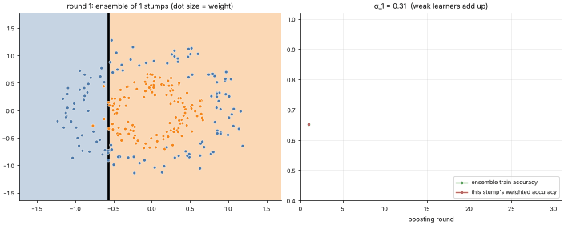

# 13 · AdaBoost
**Family:** Supervised · Classification (ensemble, boosting)

## Definition
AdaBoost builds a strong classifier from many **weak learners** (here, one-split "stumps" barely better than guessing)
trained *sequentially*. After each round it **raises the weights of the examples that were misclassified** so the next stump is forced
to focus on the hard cases. The final prediction is a weighted vote.

## Intuition
A team of mediocre specialists. The first stump draws one line. Points it got wrong become heavier (they appear bigger on screen),
so the second stump concentrates on them, and so on. Stumps that were more accurate get a louder voice (larger α).

## The math
    init   wᵢ = 1/n
    for t = 1..T:  fit stump h_t on weighted data;   ε_t = Σ wᵢ·1[h_t(xᵢ) ≠ yᵢ]
                   α_t = ½ ln((1 − ε_t)/ε_t)
                   wᵢ ← wᵢ · exp(−α_t yᵢ h_t(xᵢ)) , then normalise      (y, h ∈ {−1,+1})
    final  H(x) = sign( Σ_t α_t h_t(x) )
    AdaBoost = gradient boosting on the exponential loss; sensitive to label noise and outliers (they get exponentially heavy).

## What the animation shows
A ring-shaped class that no single vertical/horizontal line can separate. Left: point size = current weight, black line = the newest
stump, background = the ensemble's current decision. Right: the ensemble's accuracy climbs while each stump's own weighted error stays close to 0.5.

## Try this
- Add 10 % label noise and watch the weights explode on the flipped points.
- Replace stumps by depth-2 trees and compare how many rounds are needed.

## Formats
- **Interactive Notebook:** [`notebooks/13_adaboost.ipynb`](../notebooks/13_adaboost.ipynb)
- **Standalone Python Script:** [`lessons/13_adaboost.py`](../lessons/13_adaboost.py)

