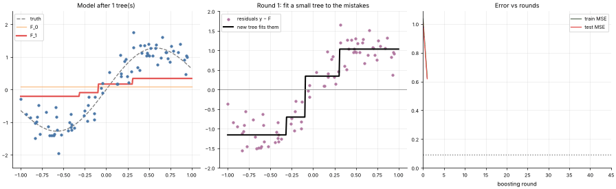
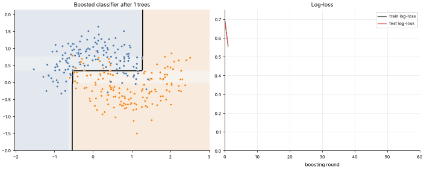

# 14 · Gradient Boosting (GBM / XGBoost / LightGBM idea)
**Family:** Supervised · Regression & Classification (ensemble, boosting)

## Definition
Gradient boosting builds a model as a sum of small trees added one at a time, where each new tree is trained to predict the
**negative gradient of the loss** (for squared error: simply the *residuals*, the current mistakes). It is gradient descent
performed in function space.

## Intuition
Start with a crude guess (the mean). Look at what is still wrong (residuals), fit a small tree to explain part of that error,
add a fraction (the learning rate) of it, and repeat. Each tree is a small correction, and many corrections add up to a sharp, accurate model.

## The math
    F₀(x) = mean(y)       (classification: log-odds of the base rate)
    for m = 1..M:
        rᵢ = −∂L(yᵢ, F(xᵢ))/∂F(xᵢ)           squared error: rᵢ = yᵢ − F(xᵢ);   log-loss: rᵢ = yᵢ − σ(F(xᵢ))
        fit a shallow tree h_m to the pseudo-residuals r
        F_m(x) = F_{m−1}(x) + η · h_m(x)       η = learning rate (shrinkage), typically 0.01–0.3
    XGBoost/LightGBM add: second-order (Newton) steps, regularized leaf values, histogram splits, subsampling.

## Practical tips
- Usually the best off-the-shelf model for tabular data. Tune learning rate × number of trees, tree depth (3–8), subsampling; use early stopping.
- Smaller η + more trees = better but slower. Sensitive to noisy labels if too many rounds.

## What the animations show
1. `14_gradient_boosting.gif` (regression): left, prediction F_m hugging the curve; middle, the *residuals* and the small tree fitted to them;
   right, train/test error. The residuals shrink and become noise.
2. `14_gradient_boosting_classification.gif`: the same idea with log-loss on moons: the probability map sculpts itself round by round.

## Try this
- Raise the learning rate to 1.0 and watch test error bounce (overfitting quickly).
- Use depth-1 stumps vs depth-4 trees at the same number of rounds.

## Formats
- **Interactive Notebook:** [`notebooks/14_gradient_boosting.ipynb`](../notebooks/14_gradient_boosting.ipynb)
- **Standalone Python Script:** [`lessons/14_gradient_boosting.py`](../lessons/14_gradient_boosting.py)

