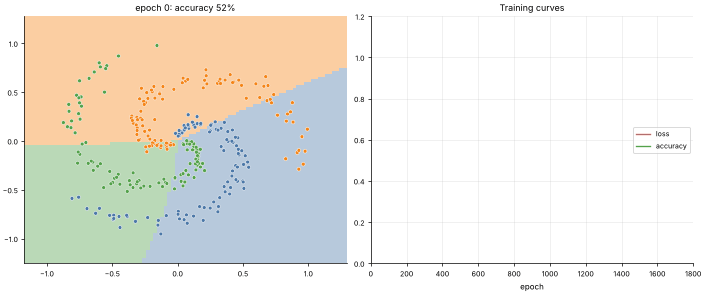

# 15 · Neural Networks (MLP) & Backpropagation
**Family:** Supervised · Deep learning (multi-layer perceptron)

## Definition
A multi-layer perceptron stacks layers of neurons. Each layer computes a linear map followed by a non-linear activation, so the
network can bend space and learn *any* smooth decision boundary (universal approximation). **Backpropagation** is the chain
rule applied efficiently from the loss back to every weight, and gradient descent then updates them all.

## Intuition
The first layers learn to re-describe the inputs (bend and stretch the plane) so that the last layer, a plain linear classifier,
can separate the classes. Without non-linear activations, stacked layers collapse into one linear layer.

## The math (2 hidden layers, tanh, softmax + cross-entropy)
    a1 = tanh(X W1 + b1)      a2 = tanh(a1 W2 + b2)      z = a2 W3 + b3      p = softmax(z)
    L = −1/n Σ log p[i, yᵢ]
    Backward:  dz  = (p − onehot(y)) / n
               dW3 = a2ᵀ dz            da2 = dz W3ᵀ      dz2 = da2 ⊙ (1 − a2²)
               dW2 = a1ᵀ dz2           da1 = dz2 W2ᵀ     dz1 = da1 ⊙ (1 − a1²)
               dW1 = Xᵀ dz1            (biases: column sums)        then  W ← W − η·dW (here with Adam)
    This file writes every line of that by hand and verifies it against numerical gradients.

## Practical tips
- Standardize inputs; initialize with Xavier/He scaling; ReLU/GELU for deep nets; Adam is a strong default.
- Overfitting control: weight decay, dropout, early stopping, more data. Batch/layer norm stabilize deep nets.

## What the animation shows
A 3-arm spiral, which no linear model can classify. Left: the decision regions the network carves out over training;
right: loss and accuracy curves. Early on the boundaries are almost straight lines; then they twist to follow the spirals.

## Try this
- Reduce hidden size to 4 units: what is the best the network can do?
- Swap tanh for ReLU (remember the derivative changes to 1[z>0]).

## Formats
- **Interactive Notebook:** [`notebooks/15_neural_network_backprop.ipynb`](../notebooks/15_neural_network_backprop.ipynb)
- **Standalone Python Script:** [`lessons/15_neural_network_backprop.py`](../lessons/15_neural_network_backprop.py)

