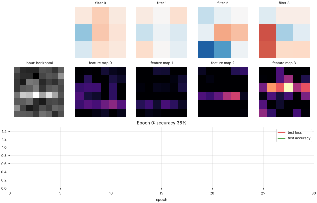

# 16 · Convolutional Neural Networks (CNN)
**Family:** Supervised · Deep learning for images / grids

## Definition
A CNN processes images with **convolution** layers: small learnable filters (here 3×3) slide across the image,
and each filter produces a *feature map* showing where its pattern occurs. **Pooling** shrinks the maps and adds tolerance
to small shifts. Dense layers at the end classify. Weight sharing makes CNNs far more efficient than fully-connected nets on images.

## Intuition
A filter is a tiny pattern detector (an edge, a corner, a stroke direction). Sliding it over the picture asks "is this pattern here?" at
every position. Stacking layers builds from edges → textures → parts → objects. We train on 8×8 images of strokes
(horizontal, vertical, two diagonals) and **watch the filters turn into oriented-edge detectors by themselves**.

## The math
    conv:   Z[f,i,j] = Σ_{k,l} W[f,k,l] · X[i+k, j+l] + b_f          (cross-correlation; "valid" padding)
    ReLU:   A = max(Z, 0)             max-pool 2×2:  M[f,i,j] = max of the 2×2 block of A
    dense:  logits = flatten(M) W₂ + b₂ ;   softmax + cross-entropy
    Backprop through the layers by hand:  dense → un-flatten → route the gradient to the arg-max of each pooling window
    → multiply by 1[Z>0] → dW[f] = Σ over positions of  dZ[f,i,j] · (image patch at i,j)
    Output size = (N − K + 2P)/S + 1.

## What the animation shows
Top row: the four 3×3 filters evolving from random noise. Middle row: the input image and the four feature maps after ReLU (bright = filter fired).
Bottom: loss/accuracy curves. The sample cycles through the four classes so you can see which filter reacts to which stroke direction.

## Try this
- Increase filters to 8, or add a second conv layer.
- Shift the test strokes by two pixels: translation tolerance comes from conv + pooling.

## Formats
- **Interactive Notebook:** [`notebooks/16_convolutional_neural_network.ipynb`](../notebooks/16_convolutional_neural_network.ipynb)
- **Standalone Python Script:** [`lessons/16_convolutional_neural_network.py`](../lessons/16_convolutional_neural_network.py)

