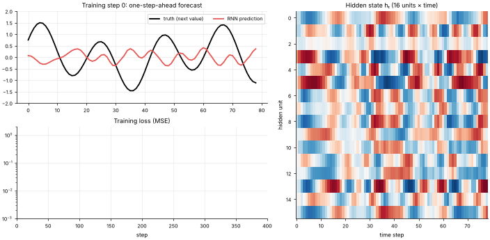

# 17 · Recurrent Neural Networks (RNN) & Backprop-Through-Time
**Family:** Supervised · Deep learning for sequences

## Definition
An RNN reads a sequence one element at a time and keeps a **hidden state** hₜ, a running summary of everything seen so far. The same weights are reused at every
time step, so it handles sequences of any length (time series, text, sensor streams).

## Intuition
Reading a sentence word by word while keeping a mental note of the story so far. At each step the note is updated from
the new word and the previous note. To train, we "unroll" the network through time (one copy per step, sharing weights) and backpropagate
through all the copies: **backpropagation through time (BPTT)**.

## The math
    hₜ = tanh(xₜ Wₓₕ + hₜ₋₁ Wₕₕ + b)           ŷₜ = hₜ W_y + b_y
    L = 1/T Σₜ (ŷₜ − yₜ)²                       gradient flows backwards through every hₜ
    ∂L/∂Wₕₕ = Σₜ  ... Π (Wₕₕᵀ · diag(1 − h²)) ...      repeated multiplication => gradients vanish (<1) or explode (>1)
    Fixes: gradient clipping (used here), gated cells (LSTM/GRU, lesson 18), attention (lesson 19).
    This file uses the autograd engine in mlatlas/nn.py, so BPTT is automatic; read the 6-line forward pass.

## Practical tips
- Clip gradient norm. Use LSTM/GRU for anything with long-range dependencies. Transformers have mostly replaced RNNs for text.
- For forecasting, teacher forcing (feed the true previous value) is used in training; at inference you feed back predictions.

## What the animation shows
A noisy two-frequency "seasonal demand" signal. Top-left: the RNN's one-step-ahead prediction (red) improving over the true signal (black).
Right: the heat-map of the 16 hidden units over time (the network's memory), bottom-left: loss curve.

## Try this
- Make the sequence length 60 and watch training get harder (vanishing gradients).
- Replace tanh by ReLU and turn clipping off.

## Formats
- **Interactive Notebook:** [`notebooks/17_recurrent_neural_network.ipynb`](../notebooks/17_recurrent_neural_network.ipynb)
- **Standalone Python Script:** [`lessons/17_recurrent_neural_network.py`](../lessons/17_recurrent_neural_network.py)

