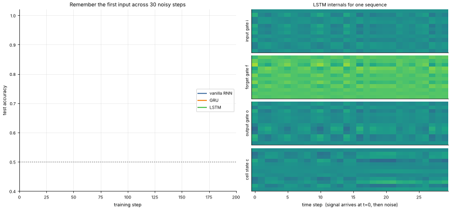

# 18 · LSTM & GRU: Gated Memory
**Family:** Supervised · Deep learning for sequences

## Definition
LSTM (Hochreiter & Schmidhuber, 1997) and GRU (Cho et al., 2014) are recurrent cells with **gates**: learned sigmoid switches that
decide what to write into memory, what to keep and what to reveal. They solve the vanishing-gradient problem of plain RNNs
because the memory (cell state) can be carried across many steps almost untouched, giving gradients a "highway".

## Intuition
A plain RNN rewrites its whole memory every step, so an early signal is quickly overwritten. An LSTM has a notebook (cell state cₜ)
with three controls: the **forget gate** (erase old notes?), the **input gate** (write new notes?), the **output gate** (read the notes out now?).
Here the task is a pure memory test: *the first input is a +1 or −1 signal, followed by 29 steps of random noise; at the end, report the sign of the first input.*

## The math (LSTM)
    [i, f, o, g] = [x, h] W + b         i,f,o = σ(·)   g = tanh(·)
    cₜ = f ⊙ cₜ₋₁ + i ⊙ g               (additive update = gradient highway)
    hₜ = o ⊙ tanh(cₜ)
    GRU (fewer parameters, no separate cell):  z = σ([x,h]Wz) , r = σ([x,h]Wr) , h̃ = tanh([x, r⊙h]W) , h = (1−z)⊙h + z⊙h̃
    Forget-gate bias initialised to +1 so the cell remembers by default.

## Practical tips
- LSTM/GRU are the standard for sequential data when transformers are overkill (streams, small data, on-device).
- GRU is faster and often equal in accuracy; LSTM can be better for very long dependencies.

## What the animation shows
Left: test accuracy during training for a vanilla RNN, GRU and LSTM on the memory task (50 % = guessing). Right: the LSTM's **input, forget, output
gates and cell state** over the 30 time steps for one sequence. Watch the cell state lock in the first signal and the forget gate stay open.

## Try this
- Lengthen the noise to 100 steps: which model still learns?
- Set the forget bias to 0 and see how much slower the LSTM trains.

## Formats
- **Interactive Notebook:** [`notebooks/18_lstm_gru_gated_memory.ipynb`](../notebooks/18_lstm_gru_gated_memory.ipynb)
- **Standalone Python Script:** [`lessons/18_lstm_gru_gated_memory.py`](../lessons/18_lstm_gru_gated_memory.py)

