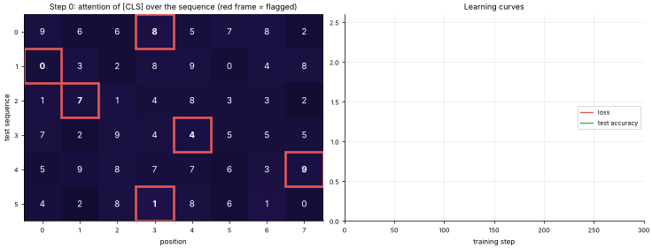
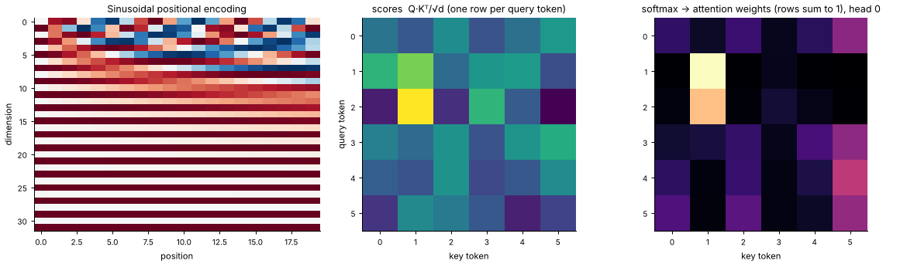

# 19 · Attention & the Transformer
**Family:** Supervised · Deep learning (sequence → sequence, language, vision)

## Definition
**Attention** lets every position in a sequence look at every other position and pull in the information it needs, weighted by relevance.
A **Transformer** stacks attention + feed-forward blocks with residual connections and layer normalization. There is no recurrence, so all
positions are processed in parallel, which is what lets models scale to GPT/BERT size.

## Intuition
Each token asks a question (**query**), advertises what it contains (**key**) and carries a payload (**value**). Similarity between
a query and every key decides how much of each value is mixed in (softmax weights). In this lesson the model must find *the one flagged digit* in a sequence of 8 digits and
report it. We train a tiny 1-layer transformer encoder and **watch its attention learn to lock onto the flagged token**.

## The math
    Q = XW_q ,  K = XW_k ,  V = XW_v
    Attention(Q,K,V) = softmax( Q Kᵀ / √d ) V               (√d keeps the softmax from saturating)
    Multi-head: run h attention "heads" on d/h-dimensional slices, concatenate, project with W_o
    Block:  X ← LayerNorm(X + Attention(X))      X ← LayerNorm(X + FFN(X)),   FFN = ReLU(XW₁+b₁)W₂ + b₂
    Position: attention is order-blind, so add positional information (sinusoidal  sin/cos(pos/10000^(2i/d))  or learned).
    Causal mask (GPT-style) sets future positions' scores to −∞.
    Cost: O(n²) in sequence length, the reason for long-context research (sparse/linear attention, FlashAttention).

## Practical tips
- Warm-up + Adam(W), pre-LayerNorm, dropout, large batches. Pretrain on lots of data, then fine-tune.
- Also dominates vision (ViT), audio, protein folding and more.

## What the animation shows
Rows are 6 fixed test sequences; columns the 8 digit positions (the red frame marks the flagged one). The colour shows how strongly the
classification token attends to each position. Initially attention is spread out; as training progresses it snaps onto the flagged
digit. Right: loss and accuracy. A static figure `19_attention_transformer_math.png` shows positional encoding and the Q·Kᵀ → softmax maths on a toy example.

## Try this
- Remove the flag embedding: can the model still solve the task? (It cannot, and the attention shows why.)
- Add a second head by splitting d into two halves (see `multi_head_attention` in this file).

## Formats
- **Interactive Notebook:** [`notebooks/19_attention_transformer.ipynb`](../notebooks/19_attention_transformer.ipynb)
- **Standalone Python Script:** [`lessons/19_attention_transformer.py`](../lessons/19_attention_transformer.py)

