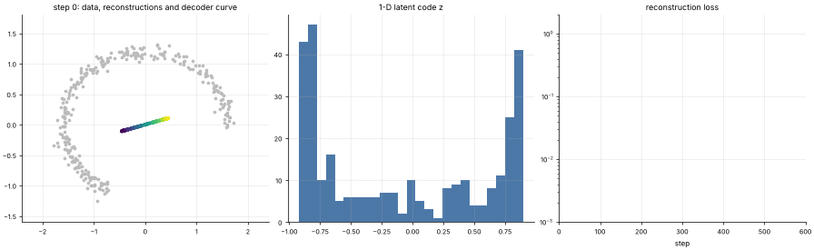

# 20 · Autoencoders
**Family:** Unsupervised · Representation learning / dimensionality reduction

## Definition
An autoencoder is a neural network trained to **reconstruct its own input** through a narrow **bottleneck**. The *encoder* compresses x into a
short code z; the *decoder* rebuilds x̂ from z. No labels are needed: the target is the input itself.

## Intuition
If the data really lives on a low-dimensional surface (a curve in 2-D), the bottleneck forces the network to discover coordinates *along* that surface.
Here noisy sensor points lie on a bent arc; a 1-number bottleneck must learn "how far along the arc am I?". It is a **non-linear PCA**: with linear layers it recovers PCA exactly.

## The math
    z = enc(x) = W₂ tanh(W₁x + b₁) + b₂          x̂ = dec(z)
    L = 1/n Σ ||x − x̂||²
    Variants: denoising AE (corrupt x, reconstruct clean x), sparse AE (penalty on z), contractive AE, convolutional AE, VAE (lesson 21).
    Uses: compression, denoising, anomaly detection (large reconstruction error = unusual), feature learning, pre-training.

## What the animation shows
Left: data (grey), each point's reconstruction (coloured by its latent value z) and the decoder's learned curve (black), the manifold it discovered. Middle: histogram of the 1-D codes.
Right: reconstruction loss. The decoder curve starts as a blob near the mean and unfolds along the arc.

## Try this
- Use a 2-D bottleneck on the same data: reconstruction becomes perfect, but is the code still meaningful?
- Add 20 off-curve points and compare their reconstruction error to inliers: that is anomaly detection.

## Formats
- **Interactive Notebook:** [`notebooks/20_autoencoder.ipynb`](../notebooks/20_autoencoder.ipynb)
- **Standalone Python Script:** [`lessons/20_autoencoder.py`](../lessons/20_autoencoder.py)

