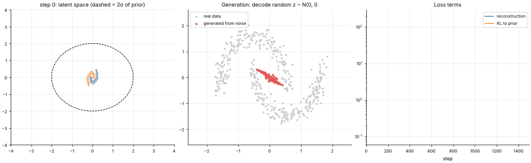

# 21 · Variational Autoencoder (VAE)
**Family:** Unsupervised · Generative model

## Definition
A VAE is an autoencoder whose code is a *probability distribution*, not a point: the encoder outputs a mean μ and variance σ² and we
sample z ~ N(μ, σ²). An extra loss pulls those distributions toward a standard normal prior N(0, I). The latent space becomes smooth and
dense, so **sampling z from the prior and decoding generates brand-new, realistic data**.

## Intuition
A plain autoencoder can scatter codes anywhere, leaving holes where the decoder produces garbage. The VAE's KL penalty packs all codes into one tidy blob
around the origin, and sampling noise forces nearby codes to decode to similar outputs. Here the data is two interleaved moons; we learn a 2-D latent
space and then generate new moon points from pure noise.

## The math
    encoder: x -> (μ, log σ²)          reparameterization trick:  z = μ + σ ⊙ ε ,  ε ~ N(0, I)   (makes sampling differentiable)
    decoder: z -> x̂
    ELBO loss:  L = E||x − x̂||² / (2s²)  +  KL( N(μ,σ²) || N(0,I) ),   KL = −½ Σ (1 + log σ² − μ² − σ²)
    Trade-off: reconstruction (accuracy) vs KL (regularity). β-VAE scales the KL term to disentangle factors.

## Practical tips
- Output tends to be blurry for images (Gaussian likelihood); VQ-VAE and diffusion models improve on that.
- Watch for "posterior collapse" (KL → 0, decoder ignores z): anneal β from 0 up.

## What the animation shows
Left: the 2-D latent space; every training point's encoded mean, coloured by moon, and the N(0,1) prior circle. Middle: data (grey) vs points *generated from random noise* (red).
Right: reconstruction and KL loss terms. Early generations are a blob; later they concentrate around the two moons. Notice that some samples still land in the gap between them: a VAE trades sharpness for coverage, one reason GANs and diffusion models give crisper samples.

## Try this
- Walk a straight line in latent space between a point of each moon and decode it (latent interpolation).
- Set the KL weight to 0 (plain AE) and sample from the prior: how many generated points are off the moons?

## Formats
- **Interactive Notebook:** [`notebooks/21_variational_autoencoder.ipynb`](../notebooks/21_variational_autoencoder.ipynb)
- **Standalone Python Script:** [`lessons/21_variational_autoencoder.py`](../lessons/21_variational_autoencoder.py)

