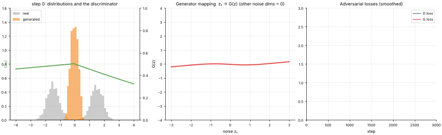

# 22 · Generative Adversarial Networks (GAN)
**Family:** Unsupervised · Generative model (adversarial training)

## Definition
A GAN trains two networks in a game. The **generator G** turns random noise into fake samples; the **discriminator D** tries to tell real samples from fakes.
G is rewarded when D is fooled; D is rewarded when it is not. At equilibrium G's samples match the real distribution and D can only guess (output 0.5).

## Intuition
A counterfeiter and a detective. As the detective gets better at spotting fakes, the counterfeiter must make better ones. We use the simplest possible
setting, 1-D data, so you can see everything: the real data are two bumps (e.g. commuter arrival times: morning and evening rush), and G must learn to map a single
bell-curve of noise onto *two* bumps.

## The math
    D(x) = P(x is real)          G(z), z ~ N(0, I)
    min_G max_D  E_x[log D(x)] + E_z[log(1 − D(G(z)))]
    In practice D minimizes BCE(real→1, fake→0); G uses the "non-saturating" loss  −log D(G(z))  (stronger gradients early on).
    Optimal discriminator for fixed G:  D*(x) = p_data(x) / (p_data(x) + p_G(x))     ->  the green curve below
    Note: the generated bumps come out a little narrower/spikier than the real ones, a mild form of mode collapse that is typical of plain GANs.
    Known troubles: mode collapse (G covers only one bump), oscillating training, vanishing gradients. Remedies: WGAN, spectral norm, careful lr.

## What the animation shows
Left: histogram of real data (grey) vs generated samples (orange) with the discriminator's belief D(x) (green line). Middle: the generator's learned mapping z → G(z); it must become
a staircase to make two bumps from one (the noise has 4 dimensions so it can also spread each bump). Right: the two losses oscillating (healthy for GANs).

## Try this
- Move the bumps further apart (±3) and see if mode collapse appears.
- Train D 5 steps per G step (WGAN-style) and compare stability.

## Formats
- **Interactive Notebook:** [`notebooks/22_generative_adversarial_network.ipynb`](../notebooks/22_generative_adversarial_network.ipynb)
- **Standalone Python Script:** [`lessons/22_generative_adversarial_network.py`](../lessons/22_generative_adversarial_network.py)

