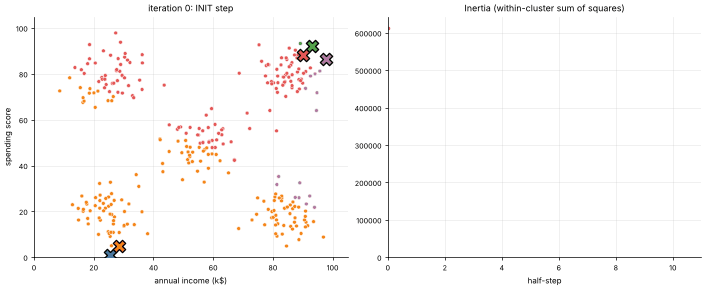

# 23 · K-Means Clustering
**Family:** Unsupervised · Clustering (centroid-based)

## Definition
K-means partitions n points into k clusters by repeatedly (1) assigning each point to its nearest **centroid** and (2) moving each centroid to the mean of the points
assigned to it (Lloyd's algorithm). It minimizes the within-cluster sum of squares (inertia).

## Intuition
Place k pins on the map at random. Every customer goes to the nearest pin; then move each pin to the centre of its customers; the borders (Voronoi cells) shift, so repeat.
It always converges, but maybe to a *local* optimum, so initialisation matters (k-means++ spreads the starting pins).

## The math
    assign:  cᵢ = argmin_k ||xᵢ − μ_k||²              update:  μ_k = mean{ xᵢ : cᵢ = k }
    objective (inertia): J = Σᵢ ||xᵢ − μ_{cᵢ}||²   (never increases; guaranteed to converge)
    Choosing k: elbow method (where J stops dropping fast), silhouette score, gap statistic, or business needs.
    k-means++: first centre uniformly at random, each next centre sampled with probability ∝ D(x)² (distance to nearest chosen centre).

## Practical tips
- Scale features; assumes round, similarly sized clusters; sensitive to outliers (use k-medoids / GMM / DBSCAN otherwise).
- Use for customer segmentation, colour quantization, vector quantization, initialising other models.

## What the animation shows
Mall customers (annual income vs spending score) with a deliberately bad random start. Each iteration has two frames: **assign** (points recolour) then **update** (centroids jump to the
cluster means, arrows show the move). Right: inertia plummets then flat-lines. The console prints the elbow curve and compares k-means++.

## Try this
- Set k=3 and k=8 and look at the segments.
- Run 20 random restarts and keep the best inertia.

## Formats
- **Interactive Notebook:** [`notebooks/23_k_means.ipynb`](../notebooks/23_k_means.ipynb)
- **Standalone Python Script:** [`lessons/23_k_means.py`](../lessons/23_k_means.py)

