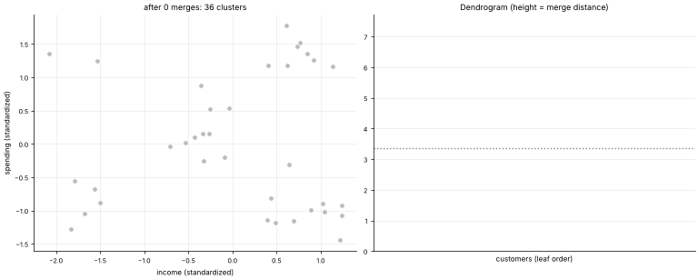

# 24 · Hierarchical (Agglomerative) Clustering
**Family:** Unsupervised · Clustering (tree-based)

## Definition
Start with every point as its own cluster, then repeatedly **merge the two closest clusters** until only one remains. The sequence of merges forms a tree, the **dendrogram**.
Cutting the tree at a chosen height gives any number of clusters, so you do not need to choose k in advance.

## Intuition
Building a family tree from similarity: the two most similar customers pair up first, then similar pairs merge, and so on. The *height* of a merge is how far apart
the two groups were; a very tall merge signals "these really are different groups", so cut just below it.

## The math
    cluster distance ("linkage"):
      single    d(A,B) = min d(a,b)          (can chain; finds elongated clusters)
      complete  d(A,B) = max d(a,b)          (compact clusters)
      average   d(A,B) = mean d(a,b)
      ward      merge the pair giving the smallest increase in total within-cluster variance:  Δ = |A||B|/(|A|+|B|) ||μ_A − μ_B||²
    naive cost O(n³), O(n² log n) with priority queues. Needs the full distance matrix (so ≈ up to tens of thousands of points).

## Practical tips
- Great for small data, taxonomies, gene expression, and when you want to explore several granularities. Use scaling.
- Ward ≈ k-means-like compact clusters; single linkage for chains.

## What the animation shows
36 customers; each frame performs one merge. Left: current clusters (singletons grey, merged clusters coloured, the newest merge circled). Right: the dendrogram growing from the bottom, with the red link as the latest merge.

## Try this
- Switch `linkage="single"` and see long chain-like merges.
- Draw a horizontal cut at distance h and count clusters.

## Formats
- **Interactive Notebook:** [`notebooks/24_hierarchical_clustering.ipynb`](../notebooks/24_hierarchical_clustering.ipynb)
- **Standalone Python Script:** [`lessons/24_hierarchical_clustering.py`](../lessons/24_hierarchical_clustering.py)

