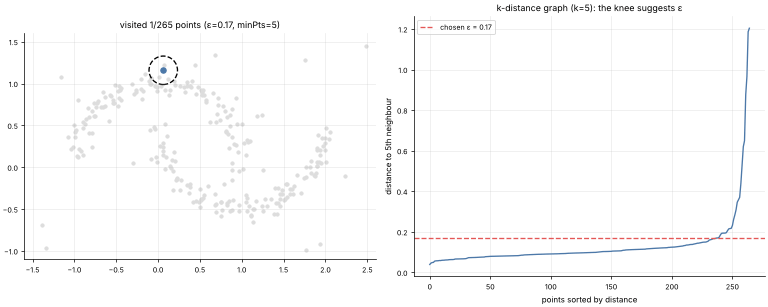

# 25 · DBSCAN (Density-Based Clustering)
**Family:** Unsupervised · Clustering (density-based) + outlier detection

## Definition
DBSCAN groups points that are packed closely together and labels isolated points as **noise**. It needs two numbers: a radius **ε** and a minimum neighbourhood size **minPts**.
Clusters can have *any shape*, and the number of clusters is discovered, not chosen.

## Intuition
Think of a crowd at a festival: dense crowds are clusters, lone wanderers are noise. A **core point** has ≥ minPts neighbours within ε. A cluster grows by hopping from core point to core point
(density-reachability); **border points** are within ε of a core point but not dense themselves.

## The math
    N_ε(p) = { q : ||p − q|| ≤ ε }          p is core  ⇔  |N_ε(p)| ≥ minPts
    expand: start at an unvisited core point, give it a new cluster id, and recursively add all points in the neighbourhoods of the core points reached.
    Choosing ε: plot the sorted distance of every point to its k-th nearest neighbour (k = minPts) and pick the "knee" (right panel).
    Complexity O(n log n) with a spatial index. HDBSCAN removes the single-ε limitation (varying densities).

## Practical tips
- Scale features first. Struggles with varying density and high dimensions. Great for geospatial data, anomaly detection and non-convex shapes (k-means fails on moons).

## What the animation shows
Two moons + scattered noise. As the algorithm visits points, the circle shows the ε-neighbourhood being examined. Filled dots = core points, hollow = border points, black × = noise;
colours = clusters, spreading along each moon. Right: the k-distance plot used to pick ε.

## Try this
- Halve ε: clusters shatter. Double it: the moons merge.
- Compare with k-means (k=2) on the same data.

## Formats
- **Interactive Notebook:** [`notebooks/25_dbscan.ipynb`](../notebooks/25_dbscan.ipynb)
- **Standalone Python Script:** [`lessons/25_dbscan.py`](../lessons/25_dbscan.py)

