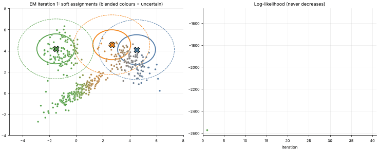

# 26 · Gaussian Mixture Models & the EM Algorithm
**Family:** Unsupervised · Clustering / density estimation (probabilistic)

## Definition
A Gaussian Mixture Model says the data was generated by choosing one of K hidden Gaussian components (with probability π_k) and drawing a point from it.
Unlike k-means, clusters can be elliptical, differently sized, and assignments are **soft**: each point has a probability of belonging to every component.
It is fitted by **Expectation-Maximization (EM)**.

## Intuition
Chicken-and-egg: if you knew which component produced each point, estimating the Gaussians would be easy; if you knew the Gaussians, assigning points would be easy.
EM alternates: guess soft assignments with the current Gaussians (E-step), then re-fit the Gaussians using those soft assignments (M-step). The likelihood never decreases.

## The math
    p(x) = Σ_k π_k N(x | μ_k, Σ_k)
    E-step:  r_ik = π_k N(xᵢ|μ_k,Σ_k) / Σ_j π_j N(xᵢ|μ_j,Σ_j)           (responsibility of component k for point i)
    M-step:  N_k = Σᵢ r_ik ;  π_k = N_k/n ;  μ_k = Σ r_ik xᵢ / N_k ;  Σ_k = Σ r_ik (xᵢ−μ_k)(xᵢ−μ_k)ᵀ / N_k
    log-likelihood  ℓ = Σᵢ log Σ_k π_k N(xᵢ|…): rises monotonically; EM finds a local optimum.
    Choosing K: BIC = −2ℓ + p·ln n (printed below). k-means is the special case of equal spherical covariances and hard assignments.

## Practical tips
- Initialise with k-means; regularise covariances (add εI) to avoid collapse onto a single point; restart several times.
- Used for soft clustering, density estimation, anomaly detection (low p(x)), speaker/background modelling.

## What the animation shows
Three overlapping, differently-shaped clusters. Each frame is one EM iteration: ellipses (1σ and 2σ) move/rotate/stretch to fit; point colours blend by responsibility (mixed colours = uncertain).
Right: the log-likelihood increasing. The console prints BIC for K = 1…6.

## Try this
- Fit K=2 and K=5 and compare the BIC.
- Initialise two means at the same point: what happens?

## Formats
- **Interactive Notebook:** [`notebooks/26_gaussian_mixture_em.ipynb`](../notebooks/26_gaussian_mixture_em.ipynb)
- **Standalone Python Script:** [`lessons/26_gaussian_mixture_em.py`](../lessons/26_gaussian_mixture_em.py)

