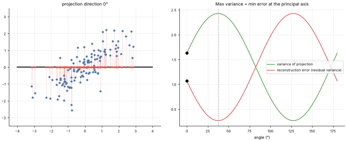
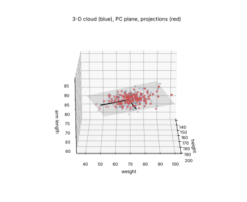

# 27 · Principal Component Analysis (PCA)
**Family:** Unsupervised · Dimensionality reduction / feature extraction

## Definition
PCA finds new orthogonal axes (principal components) ordered by how much of the data's **variance** each one captures. Keeping only the first few components compresses
the data with minimal information loss, and makes high-dimensional data visualizable.

## Intuition
Hold a flashlight to a 3-D cloud so its shadow on the wall is as *spread out* as possible: that direction is PC1. Equivalently, PC1 is the line that leaves the smallest
total squared distance from the points to their projections (the residual lines in the animation). The two views are the same by Pythagoras: variance kept + error = total.

## The math
    centre X;  covariance C = XᵀX/(n−1);   eigen-decomposition C v_k = λ_k v_k   (or SVD: X = U S Vᵀ, λ_k = s_k²/(n−1))
    projection  Z = X V_k        reconstruction  X̂ = Z V_kᵀ + mean        explained variance ratio  λ_k / Σλ
    The projection onto unit vector u has variance uᵀCu, maximised by the top eigenvector.
    Relatives: kernel PCA (non-linear), probabilistic PCA/factor analysis, ICA, truncated SVD (LSA), t-SNE/UMAP (visual, non-linear), autoencoders.

## Practical tips
- Standardize variables of different units first. Choose components via the scree plot (cumulative variance ≥ 90–95 %).
- Components are linear mixes: harder to interpret; PCA ignores labels (LDA is the supervised cousin).

## What the animations show
1. `27_pca.gif`: a line rotates through the 2-D cloud. Left: projections and residuals. Right: projected variance (peaks at the PC1 angle) and reconstruction error (lowest there).
2. `27_pca_3d.gif`: a 3-D cloud of body measurements rotates; the best-fit plane (PC1-PC2) and projected points are shown.

## Try this
- Compare PCA of raw vs standardized house-price data.
- Reconstruct the 8×8 shape images from 2, 5, 10 components.

## Formats
- **Interactive Notebook:** [`notebooks/27_pca.ipynb`](../notebooks/27_pca.ipynb)
- **Standalone Python Script:** [`lessons/27_pca.py`](../lessons/27_pca.py)

