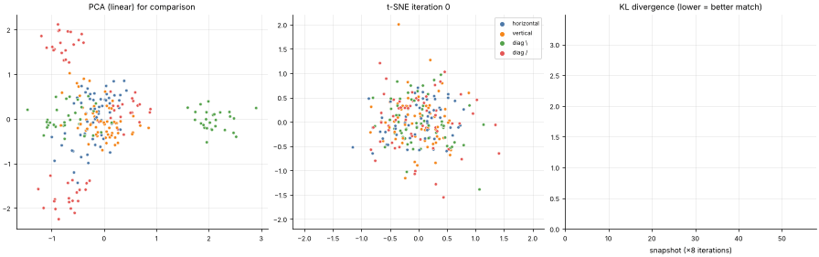

# 28 · t-SNE (Non-linear Embedding for Visualization)
**Family:** Unsupervised · Dimensionality reduction (visualization)

## Definition
t-SNE maps high-dimensional points to 2-D so that **neighbours stay neighbours**. It converts distances into neighbour probabilities in both spaces and moves the 2-D points
until the two probability distributions match (minimizing KL divergence).

## Intuition
Imagine points repelling each other in the plane, but each pair also attached by a spring whose strength is how similar they were in the original space.
Similar points get pulled together into clusters, dissimilar ones pushed apart. Heavy-tailed (Student-t) similarities in 2-D give clusters room to separate ("crowding problem").

## The math
    High-D:  p_{j|i} = exp(−||xᵢ−xⱼ||²/2σᵢ²) / Σ_k exp(−||xᵢ−x_k||²/2σᵢ²) ,   P = (p_{j|i} + p_{i|j}) / 2n
             σᵢ chosen per point by binary search so the effective neighbour count = perplexity (≈ 5–50)
    Low-D:   q_ij = (1 + ||yᵢ−yⱼ||²)⁻¹ / Σ_{k≠l} (1 + ||y_k−y_l||²)⁻¹
    Cost:    KL(P||Q) = Σ p_ij log(p_ij/q_ij)          gradient:  4 Σⱼ (p_ij − q_ij)(yᵢ−yⱼ)(1+||yᵢ−yⱼ||²)⁻¹
    Tricks: early exaggeration (×12 for 100 iterations), momentum, adaptive gains.

## Practical tips
- For **visualization only**: distances between clusters and cluster sizes are not meaningful; run with several perplexities and seeds. UMAP is faster and preserves more global structure.
- Do not use t-SNE coordinates as features for a model.

## What the animation shows
240 noisy 8×8 stroke images (64-D, 4 classes). Left: PCA's 2-D linear projection (static) for contrast. Middle: the t-SNE embedding unfolding from a random blob into 4 clusters. Right: the KL divergence falling.

## Try this
- Try perplexity 5 and 100.
- Run t-SNE on `data.mall_customers` plus 5 random noise columns.

## Formats
- **Interactive Notebook:** [`notebooks/28_tsne.ipynb`](../notebooks/28_tsne.ipynb)
- **Standalone Python Script:** [`lessons/28_tsne.py`](../lessons/28_tsne.py)

