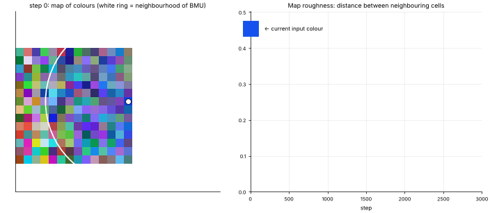

# 29 · Self-Organizing Map (SOM / Kohonen map)
**Family:** Unsupervised · Neural clustering & topology-preserving visualization

## Definition
A SOM is a grid of neurons, each holding a weight vector living in the same space as the data. Training shows data points one by one; the **best-matching unit (BMU)** and its grid
neighbours are pulled toward the point. The result is a 2-D map in which **similar inputs land on nearby cells**: clustering and visualization in one.

## Intuition
Spread a stretchy fishing net over a cloud of points and keep tugging it toward random points. Early on, tugs are big and affect a wide area (the net finds the overall shape); later tugs are small and local (fine tuning).
Here the "points" are random colours: the map organizes itself into a smooth colour atlas, with red next to orange, never next to cyan.

## The math
    BMU:       c = argmin_k ||x − w_k||
    update:    w_k ← w_k + η(t) · h(k, c, t) · (x − w_k)
    neighbourhood  h = exp(−||pos_k − pos_c||² / 2σ(t)²)         η(t) = η₀ e^{−t/τ} ,  σ(t) = σ₀ e^{−t/τ}
    Quantization error = mean ||x − w_BMU||.  U-matrix (distance between neighbouring cells) reveals cluster borders.

## Practical tips
- Good for exploratory visualization of high-dimensional records (customers, sensor profiles, genes). Hex grids, toroidal maps and batch training are common variants.
- Modern alternatives for visualization: UMAP, t-SNE. SOM's advantage is a fixed, reusable grid map.

## What the animation shows
Left: the 14×14 map's weights shown as colours, with the BMU of the current sample ringed and the neighbourhood radius drawn. Right: the roughness (average colour difference between neighbouring cells) collapsing as the map organizes itself.

## Try this
- Feed it 3-D points from `data.mall_customers` plus a third feature; colour cells by the dominant segment.
- Make the grid 4×4 and see it behave like k-means with 16 clusters.

## Formats
- **Interactive Notebook:** [`notebooks/29_self_organizing_map.ipynb`](../notebooks/29_self_organizing_map.ipynb)
- **Standalone Python Script:** [`lessons/29_self_organizing_map.py`](../lessons/29_self_organizing_map.py)

