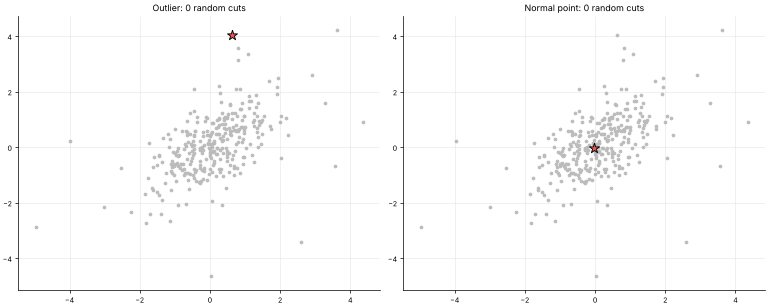
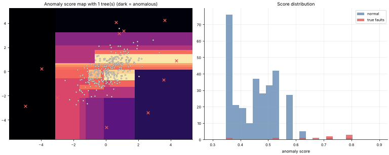

# 30 · Isolation Forest (Anomaly Detection)
**Family:** Unsupervised · Anomaly / outlier detection

## Definition
Isolation Forest detects anomalies by how *easy they are to isolate*. It builds many random trees: pick a random feature, pick a random split value between the min and max,
and recurse until each point sits alone. Anomalies are few and different, so random cuts separate them in **very few splits**; normal points deep inside the crowd need many.

## Intuition
Play "20 questions" with random questions. To single out a faulty machine whose temperature is far from everyone else, one or two cuts suffice. To single out one typical machine
in the middle of a dense cloud you must keep cutting. Short average path length ⇒ anomaly.

## The math
    path length h(x) = number of edges from the root to the leaf that isolates x   (+ c(size) correction for unfinished leaves)
    c(n) = 2(ln(n−1) + 0.5772) − 2(n−1)/n         expected path length in an unsuccessful BST search (the normaliser)
    anomaly score  s(x) = 2^{ −E[h(x)] / c(ψ) }    ->  near 1: anomaly,  well below 0.5: normal,  ≈ 0.5: no clear anomaly
    Each tree uses a small random subsample ψ (e.g. 256), which makes it fast (linear time) and robust to "swamping".
    Related: LOF (local density), One-Class SVM, autoencoder reconstruction error (lesson 20), Gaussian mixture density (lesson 26).

## Practical tips
- Choose the score threshold from the expected contamination rate or business cost; no labels needed.
- Axis-parallel cuts can create artefacts (Extended Isolation Forest fixes it). Works well on tabular sensor/finance/log features.

## What the animations show
1. `30_isolation_forest_anomaly_detection.gif`: random cuts isolating an **outlier** (left, ~3 cuts) vs a **normal point** (right, many cuts). The red region is the isolated cell.
2. `30_isolation_forest_anomaly_detection_forest.gif`: adding trees one by one; the anomaly-score map stabilises and the true faults light up.

## Try this
- Add a tight second cluster of 12 anomalies. Does "few and different" still hold? (masking)
- Compare the AUC of Isolation Forest vs a single Gaussian fit.

## Formats
- **Interactive Notebook:** [`notebooks/30_isolation_forest_anomaly_detection.ipynb`](../notebooks/30_isolation_forest_anomaly_detection.ipynb)
- **Standalone Python Script:** [`lessons/30_isolation_forest_anomaly_detection.py`](../lessons/30_isolation_forest_anomaly_detection.py)

