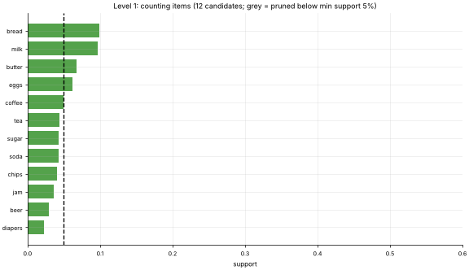

# 31 · Association Rules & the Apriori Algorithm
**Family:** Unsupervised · Pattern mining (market-basket analysis)

## Definition
Association-rule mining finds items that frequently occur together in transactions and states them as rules "if {bread} then {butter}".
**Apriori** finds all *frequent itemsets* efficiently by growing them level by level and pruning with one key fact: **a set can only be frequent if all its subsets are frequent**.

## Intuition
Count single items first; throw away rare ones. Only combine survivors into pairs; count and prune; combine surviving pairs into triples, and so on.
Whole branches of the search space are never counted. Then turn frequent sets into rules and rank them by how much they beat chance (lift).

## The math
    support(A)        = P(A) = (# baskets containing A) / N
    confidence(A→B)   = support(A∪B) / support(A) = P(B | A)
    lift(A→B)         = confidence / support(B)     (>1: positively associated, 1: independent, <1: substitutes)
    Apriori principle: support(S) ≤ support(T) for any T ⊂ S   ⇒  prune a candidate if any subset is infrequent.
    Faster alternatives: FP-Growth, Eclat. Applications: recommendations, store layout, cross-selling, log/alert correlation, web-usage mining.

## Practical tips
- Choose min-support to the order of "enough baskets to matter"; sort rules by lift, not only confidence (popular items inflate confidence).
- Association is not causation. Beware of many spurious rules at tiny support.

## What the animation shows
600 synthetic supermarket baskets with planted patterns (bread→butter→jam, coffee→sugar, diapers→beer, chips→soda). Each stage grows the bars of candidate itemsets;
those below the dashed min-support line turn grey and are pruned. The last frames plot every discovered rule: support vs confidence, coloured by lift.

## Try this
- Lower min support to 2 % and watch the number of candidates explode.
- Add the rule "tea → lemon" to `data.baskets` and confirm Apriori finds it.

## Formats
- **Interactive Notebook:** [`notebooks/31_apriori_association_rules.ipynb`](../notebooks/31_apriori_association_rules.ipynb)
- **Standalone Python Script:** [`lessons/31_apriori_association_rules.py`](../lessons/31_apriori_association_rules.py)

