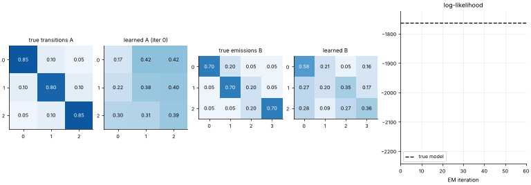
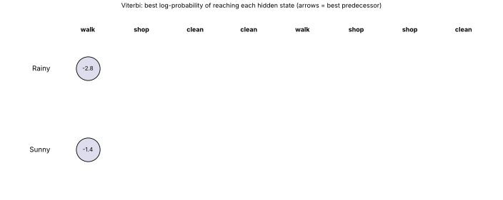

# 32 · Hidden Markov Models (HMM): Viterbi & Baum-Welch
**Family:** Probabilistic sequence models (supervised or unsupervised)

## Definition
An HMM assumes a system moves through **hidden states** (not observed) following a Markov chain, and each state emits an **observable** symbol/measurement.
From the visible sequence you can: **evaluate** its likelihood (forward algorithm), **decode** the most likely hidden path (Viterbi), and **learn** the parameters (Baum-Welch = EM).

## Intuition
You never see the weather where your friend lives, only what they did each day (walk, shop, clean). Rainy days make cleaning likely, sunny days walking. From a week of activities you can infer
the likely weather pattern. In engineering: hidden machine health (healthy/degraded/failing) from vibration readings; speech phonemes from audio; gene regions from DNA.

## The math
    parameters  π (initial probs), A_ij = P(sₜ₊₁=j | sₜ=i) (transitions), B_i(o) = P(o | state i) (emissions)
    Forward:   αₜ(j) = [Σ_i αₜ₋₁(i) A_ij] · B_j(oₜ)                  P(o) = Σ_j α_T(j)      (O(T·N²))
    Viterbi:   δₜ(j) = max_i [δₜ₋₁(i) A_ij] · B_j(oₜ) ,  ψₜ(j) = argmax_i ... ;  backtrack from argmax δ_T
    Baum-Welch (EM):  E-step: γₜ(i)=P(sₜ=i|o), ξₜ(i,j)=P(sₜ=i,sₜ₊₁=j|o) via forward-backward;
                      M-step: A_ij = Σξ/Σγ ,  B_i(o)=Σ_{t:oₜ=o} γₜ(i)/Σγₜ(i)
    Use log-probabilities or scaling to avoid underflow. Modern relatives: CRFs, Kalman filters (continuous states), RNNs/transformers.

## What the animations show
1. `32_hidden_markov_model_viterbi.gif`: the Viterbi trellis built column by column for the observation sequence walk, shop, clean, clean, walk, shop, shop, clean; best-predecessor arrows; then the backtracked hidden path in red.
2. `32_hidden_markov_model.gif`: Baum-Welch learning a 3-state model from 1500 emitted symbols starting from near-uniform random guesses; learned transition/emission heat-maps (states re-ordered to match the truth) converge to the true ones as the log-likelihood rises.

## Try this
- Add a 3rd observation symbol or a 3rd hidden state to the Viterbi example.
- Use fewer training symbols (100) and watch Baum-Welch overfit/local optima.

## Formats
- **Interactive Notebook:** [`notebooks/32_hidden_markov_model.ipynb`](../notebooks/32_hidden_markov_model.ipynb)
- **Standalone Python Script:** [`lessons/32_hidden_markov_model.py`](../lessons/32_hidden_markov_model.py)

