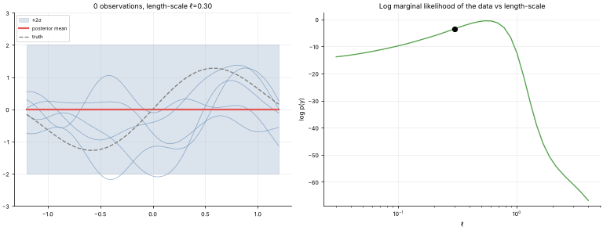

# 33 · Gaussian Processes (GP) Regression
**Family:** Supervised · Bayesian non-parametric regression

## Definition
A Gaussian process is a distribution over *functions*. You choose a **kernel** that says how similar the outputs at two inputs should be; conditioning on the observed points gives, at every new input,
a full Gaussian predictive distribution: a **mean** and a **calibrated uncertainty**. It is regression that knows what it does not know.

## Intuition
Draw random smooth curves (the prior). Every time you observe a data point, throw away all the curves that miss it. What remains is a bundle of plausible functions: tight near data, fanning out
away from it. The kernel's **length-scale** decides how wiggly the plausible functions are.

## The math
    f ~ GP(0, k),    k(x,x') = σ_f² exp(−(x−x')²/2ℓ²)               (RBF kernel)
    data (X, y) with noise σ_n:   K = k(X,X) + σ_n² I
    posterior mean   μ(x*) = k(x*,X) K⁻¹ y
    posterior var    σ²(x*) = k(x*,x*) − k(x*,X) K⁻¹ k(X,x*)
    hyper-parameters (ℓ, σ_f, σ_n) are chosen by maximizing the marginal likelihood  log p(y) = −½ yᵀK⁻¹y − ½ log|K| − (n/2) log 2π.
    Cost O(n³) in the number of points (sparse GPs / inducing points help). Uses: Bayesian optimization, surrogate models, geostatistics (kriging), small-data science.

## What the animation shows
Phase 1: observations arrive one at a time: the mean (red), the ±2σ band and five posterior function samples (thin) tighten around the data. Phase 2: with all data fixed, the length-scale ℓ sweeps
from tiny (overfits, wiggly) to huge (underfits, flat), with the marginal likelihood shown so you can see why it picks a middle value.

## Try this
- Swap the RBF for a periodic kernel and fit the seasonal sales data.
- Add 20 noisy points to the same location and watch σ shrink only slightly (noise ≠ ignorance).

## Formats
- **Interactive Notebook:** [`notebooks/33_gaussian_process.ipynb`](../notebooks/33_gaussian_process.ipynb)
- **Standalone Python Script:** [`lessons/33_gaussian_process.py`](../lessons/33_gaussian_process.py)

