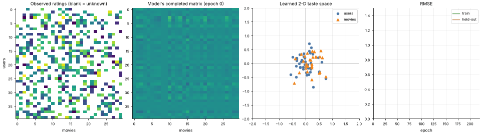

# 34 · Matrix Factorization & Recommender Systems
**Family:** Unsupervised/supervised hybrid · Collaborative filtering

## Definition
A recommender predicts ratings people *haven't given yet*. **Matrix factorization** approximates the (mostly empty) user×item rating matrix R by the product of two thin matrices:
user vectors U and item vectors V. The rating of user u for item i is predicted by the dot product u·v_i. Each dimension is a learned "taste" (e.g. action vs romance).

## Intuition
Users and items live in the same small "taste space". If your vector points the same way as a movie's vector, you'll probably like it. We never tell the model what the dimensions mean:
fitting only the *observed* ratings makes similar users and similar items drift together. Here the true taste space is 2-D, so we can literally watch users and movies organise on a map.

## The math
    R̂_ui = μ + U_u · V_i                       (add user/item biases b_u + b_i in practice)
    minimize over U, V:   Σ_{(u,i) observed} (R_ui − R̂_ui)²  +  λ (||U||² + ||V||²)
    SGD:      e = R_ui − U_u·V_i ;  U_u ← U_u + η (e V_i − λ U_u) ;  V_i ← V_i + η (e U_u − λ V_i)
    Alternating least squares (ALS) solves each side in closed form and parallelizes well.
    Evaluate on **held-out ratings** (RMSE). Cold-start problem: no history for new users/items → use content features.
    Beyond: implicit feedback (clicks), factorization machines, two-tower neural networks, transformers for sequences.

## What the animation shows
Panels: (1) the observed ratings (grey = missing), (2) the model's completed matrix as it trains, (3) the 2-D taste space with users (circles) and movies (triangles),
(4) train/test RMSE. The completed matrix fills in plausible values for the grey cells, and test RMSE drops without seeing those entries.

## Try this
- Use 1 or 5 latent factors and compare held-out RMSE (under/overfitting!).
- Increase λ and see how embeddings shrink toward the centre.

## Formats
- **Interactive Notebook:** [`notebooks/34_matrix_factorization_recommender.ipynb`](../notebooks/34_matrix_factorization_recommender.ipynb)
- **Standalone Python Script:** [`lessons/34_matrix_factorization_recommender.py`](../lessons/34_matrix_factorization_recommender.py)

