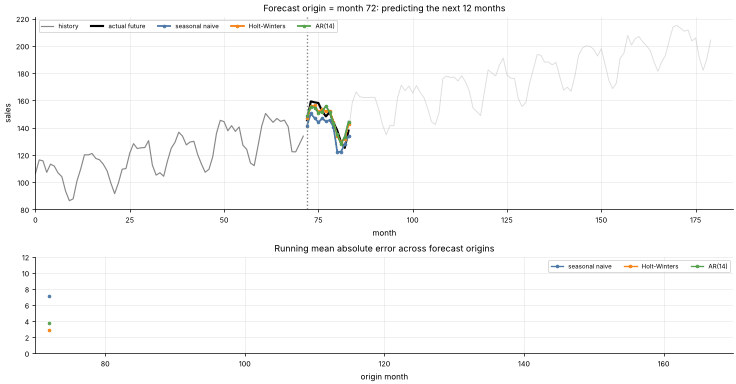

# 35 · Time-Series Forecasting: Smoothing, Holt-Winters & Autoregression
**Family:** Supervised · Forecasting

## Definition
Time-series models predict future values from the past, exploiting **trend** (long-run direction), **seasonality** (repeating cycles) and **autocorrelation** (today depends on yesterday).
We compare three classics on monthly sales: the **seasonal-naive** baseline, **Holt-Winters** (triple exponential smoothing) and an **autoregressive AR(p)** model fitted by least squares.

## Intuition
- Seasonal naive: "next March will look like last March." Hard to beat on simple data.
- Holt-Winters: keep three running estimates, a *level*, a *trend*, and 12 *seasonal offsets*, each updated by exponential smoothing: recent data counts more.
- AR(p): regress today on the last p values; with p ≥ 12 it can learn the yearly cycle and the trend from the data itself.
Always evaluate with **walk-forward (rolling-origin) validation**: never shuffle time series, and never train on the future.

## The math
    Holt-Winters (additive):   ℓₜ = α(yₜ − sₜ₋ₘ) + (1−α)(ℓₜ₋₁ + bₜ₋₁)
                               bₜ = β(ℓₜ − ℓₜ₋₁) + (1−β) bₜ₋₁          sₜ = γ(yₜ − ℓₜ) + (1−γ) sₜ₋ₘ
                               forecast  ŷₜ₊ₕ = ℓₜ + h·bₜ + sₜ₊ₕ₋ₘ
    AR(p):  yₜ = c + φ₁yₜ₋₁ + … + φ_p yₜ₋p + εₜ          fitted by least squares; multi-step forecasts feed predictions back in.
    ARIMA(p,d,q) = AR + differencing d times (removes trend) + moving-average errors q; SARIMA adds seasonal terms.
    Metrics: MAE, RMSE, MAPE, MASE (scaled vs naive).  Modern: Prophet, ETS, gradient boosting on lag features, N-BEATS, transformers.

## What the animation shows
The forecast origin walks forward through the history. Top: the next 12 months predicted by each method against the truth. Bottom: running average MAE of each method across origins so far.

## Try this
- Increase the noise in `data.time_series` and see which method degrades most.
- Change p of the AR model (4, 12, 24).

## Formats
- **Interactive Notebook:** [`notebooks/35_time_series_forecasting.ipynb`](../notebooks/35_time_series_forecasting.ipynb)
- **Standalone Python Script:** [`lessons/35_time_series_forecasting.py`](../lessons/35_time_series_forecasting.py)

