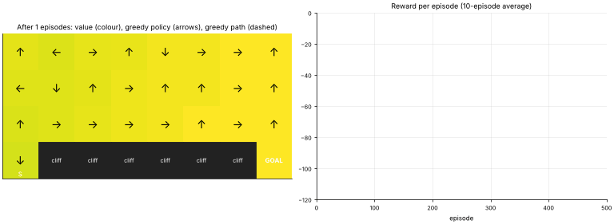
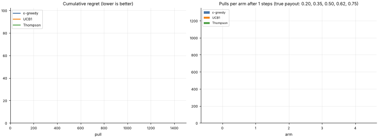

# 36 · Reinforcement Learning: Q-Learning & Bandits
**Family:** Reinforcement learning (learning from rewards by interaction)

## Definition
An **agent** interacts with an **environment**: it observes a state, takes an action, receives a reward and a new state. The goal is a **policy** maximizing the long-run (discounted) reward.
There is no labelled dataset; the agent must **explore** to discover what pays off and **exploit** what it already knows.

## Intuition
*Cliff walking*: the agent must get from the start (bottom-left) to the goal (bottom-right). Each step costs −1 (so shorter is better); stepping on the cliff costs −100 and teleports back to the start.
Q-learning learns a table Q(state, action) = "how good is this move from here, assuming I act well afterwards". Early on the agent stumbles; later its greedy arrows form a route.
*Bandits* are the one-state special case: several slot machines with unknown payout rates; pull them to maximise winnings (A/B testing, ad selection).

## The math
    Return G = Σ γᵗ rₜ              Q*(s,a) = E[r + γ max_a' Q*(s',a')]        (Bellman optimality)
    Q-learning update:   Q(s,a) ← Q(s,a) + α [ r + γ max_a' Q(s',a') − Q(s,a) ]          (off-policy, model-free)
    ε-greedy exploration: random action with prob ε, else argmax Q.     SARSA uses the action actually taken next (safer path near the cliff).
    Bandit strategies:  ε-greedy ;  UCB1:  argmax μ̂ₐ + √(2 ln t / nₐ) ;  Thompson sampling: sample p̂ₐ ~ Beta(1+wins, 1+losses), pull the argmax.
    Regret = Σ (best arm mean − chosen arm mean).      Deep RL replaces the table with a neural network (DQN) or learns the policy directly (policy gradients, PPO, actor-critic).

## What the animations show
1. `36_reinforcement_learning.gif`: left, the value of each grid cell (max Q) with arrows for the greedy policy and the greedy path (dashed); right, reward per episode. Early policies fall off the cliff, later ones find the shortest safe-ish path.
2. `36_reinforcement_learning_bandits.gif`: three bandit strategies on 5 slot machines: pull counts per arm and cumulative regret. Smart exploration (UCB, Thompson) beats naive ε-greedy.

## Try this
- Implement SARSA and compare the learned path to Q-learning's.
- Change ε to 0.3, or decay it over time.

## Formats
- **Interactive Notebook:** [`notebooks/36_reinforcement_learning.ipynb`](../notebooks/36_reinforcement_learning.ipynb)
- **Standalone Python Script:** [`lessons/36_reinforcement_learning.py`](../lessons/36_reinforcement_learning.py)

